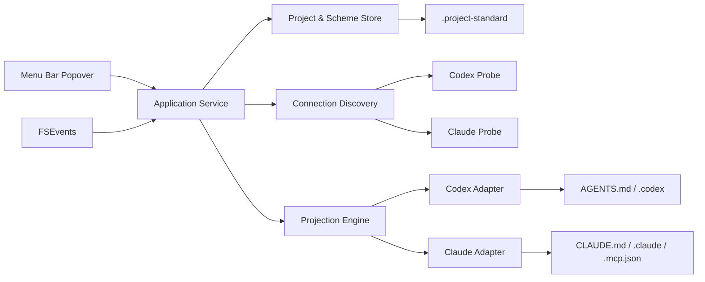

# macOS 技术方案

**状态：** MVP 5.0 已实现并通过构建、事务测试及本机 Codex App Server/Claude 能力探针验证；方案包含实际内容时最高覆盖 7/7。详见 `implementation-status.md`。

## 1. 技术选型

首版使用 Swift 6、AppKit 和 SwiftUI，最低支持 macOS 13。

- AppKit `NSStatusItem` 创建菜单栏入口，`NSPopover` 承载固定宽度、内容自适应高度的小界面。
- SwiftUI 负责方案列表、详情列表、接入开关和状态渲染，通过 `NSHostingController` 嵌入 Popover。
- `NSOpenPanel` 选择项目根目录；App Sandbox 下保存 security-scoped bookmark，后续启动恢复授权。
- 普通项目首次接入时先在同级临时目录生成最小 `.project-standard`，完成后通过同卷 rename 原子安装；已有或不完整目录不被覆盖。
- `NSWorkspace.shared.open(_:)` 用默认应用打开文件；目录调用 `activateFileViewerSelecting(_:)`。
- FSEvents 监听已授权项目目录及用户明确授权的配置目录。事件防抖后做增量重扫，事件丢失时回退到完整扫描。
- `SMAppService.mainApp` 只用于用户主动开启“登录时启动”。

Apple 的公开 API 支持状态栏项目、内容尺寸 Popover、系统文件打开、安全书签、文件系统变更通知与登录项注册：[NSStatusBar](https://developer.apple.com/documentation/appkit/nsstatusbar)、[NSPopover](https://developer.apple.com/documentation/appkit/nspopover)、[NSWorkspace](https://developer.apple.com/documentation/appkit/nsworkspace)、[security-scoped bookmarks](https://developer.apple.com/documentation/foundation/nsurl)、[File System Events](https://developer.apple.com/documentation/coreservices/file_system_events)、[SMAppService](https://developer.apple.com/documentation/servicemanagement/smappservice)。

## 2. 总体结构



核心模块：

| 模块 | 职责 |
|---|---|
| `ProjectStore` | 解析项目、保存安全书签、读取 manifest |
| `SchemeStore` | 读取七类源文件、计算摘要与文件指纹 |
| `ConnectionDiscovery` | 调用端探针，归一化接入配置并生成匿名指纹 |
| `ProjectionEngine` | 事务快照、原子写入、校验、回滚、取消 |
| `ClientAdapter` | 声明端能力并生成、检查、移除该端投影 |
| `FileWatcher` | 监听源文件、投影文件和授权配置根目录 |
| `BindingStore` | 保存接入开关、校验状态和最近成功 digest，不保存凭据 |

## 3. 项目源格式

项目根目录内的 `.project-standard/` 是唯一真相：

```text
.project-standard/
├── manifest.json
└── schemes/
    └── base/
        ├── prompt.md
        ├── rules.md
        ├── memory.md
        ├── requirements.md
        ├── skills/
        ├── tools-mcp.json
        └── permissions-hooks.json
```

`manifest.json` 只保存可移植信息：

```json
{
  "schemaVersion": 1,
  "projectId": "project-standard-demo",
  "schemes": [
    {
      "id": "base",
      "name": "默认项目规范",
      "sources": {
        "prompt": "schemes/base/prompt.md",
        "rules": "schemes/base/rules.md",
        "memory": "schemes/base/memory.md",
        "requirements": "schemes/base/requirements.md",
        "skills": "schemes/base/skills",
        "toolsMcp": "schemes/base/tools-mcp.json",
        "permissionsHooks": "schemes/base/permissions-hooks.json"
      }
    }
  ]
}
```

机器相关数据通过 `FileManager.default.urls(for: .applicationSupportDirectory, in: .userDomainMask)` 保存；在 App Sandbox 下该 API 会解析到应用容器内的 Application Support。数据包括安全书签、匿名 profile fingerprint、scheme binding、adapter version、校验结果和去敏日志，不进入 Git。

## 4. 领域模型（设计示意）

```swift
struct ConnectionProfile: Codable, Identifiable {
    let id: String                 // salted fingerprint
    let client: ClientKind
    let authentication: AuthKind
    let provider: ProviderKind
    let routeLabel: String?
    let configSource: ConfigSource
    let confidence: DetectionConfidence
}

struct ApplicationBinding: Codable {
    let projectID: String
    let profileID: String
    var schemeID: String
    var enabled: Bool
    var sourceDigest: String
    var adapterVersion: String
    var validation: ValidationResult
}
```

上述模型是架构设计示意。当前实现以归一化的客户端、认证类型和 Provider 标签生成稳定 profile ID，未实现安装级 salt 或 digest。真实数据结构以 `Sources/ProjectStandardCore/Models.swift` 为准。禁止加入 Token、Key、Cookie、邮箱和完整 Base URL 查询参数。

## 5. 适配器协议（设计示意）

```swift
protocol ClientAdapter {
    var id: String { get }
    func discover(in context: DiscoveryContext) async -> [ConnectionProfile]
    func plan(scheme: ResolvedScheme, for profile: ConnectionProfile) async throws -> ProjectionPlan
    func apply(_ plan: ProjectionPlan) async throws -> ProjectionReceipt
    func validate(_ receipt: ProjectionReceipt) async -> ValidationResult
    func cancel(_ receipt: ProjectionReceipt) async throws
}
```

上述协议是扩展方向；当前适配逻辑集中在 `ProjectionEngine` 与 `ProjectionDestination` 中。适配器需提供能力清单：七类中的 `supported / partial / unsupported`、支持的客户端版本范围、目标文件、拥有的键或 managed block 标记。UI 的 `7/7` 来自实际验证结果，不能由开关状态推断。

### CodexAdapter

- 规则类内容写入项目根 `AGENTS.md` 的受管区块。区块只引导读取 `.project-standard` 下当前方案的 Prompt、Rules、记忆和项目要求；保留区块外用户内容。
- Skills 使用项目级发现目录的相对符号链接或生成副本；选型由版本能力探针确定。
- MCP、权限、Hooks 只投影到当前 Codex 版本明确支持的项目级键。可移植的 `Bash(...)` 权限写入 `.codex/rules/project-standard.rules`；其他 Claude 专用权限不计入 Codex 生效结果。Provider、认证、Profile 和路由继续属于用户级连接配置，不能由项目方案覆盖。
- 当前认证模式通过 Codex App Server 的 `account/read` 与 `account/updated` 识别；Provider 通过 `config/read` 获取，`fs/watch` 监听配置目录后重新读取。用户级配置只解析非秘密元数据，不直接读取 `auth.json`。
- App Sandbox 无法访问 `.codex` 时，紧凑页脚提供一次性目录授权入口并保存 security-scoped bookmark；不申请 Full Disk Access。

OpenAI 官方文档区分 ChatGPT 登录与 API Key 登录，并说明 Codex App Server 提供账号状态与变化事件：[身份验证](https://learn.chatgpt.com/zh-Hans/docs/auth)、[App Server](https://learn.chatgpt.com/zh-Hans/docs/app-server)。

### ClaudeCodeAdapter

- 规则类内容写入项目根 `CLAUDE.md` 的受管区块，并引导读取当前方案源文件。
- Skills 映射到 Claude Code 当前版本支持的项目技能目录。
- MCP 生成或合并项目级 `.mcp.json` 中本应用拥有的 server 键。
- 权限和 Hooks 生成或合并 `.claude/settings.json` 中本应用拥有的键。
- Anthropic 登录、API Key、Bedrock、Vertex 与 Gateway 只作为接入识别信号。方案不写认证值。

Anthropic 官方资料确认 Claude Code 存在多种认证路径、项目级 `.mcp.json` 与权限工具配置：[安装与认证](https://docs.anthropic.com/en/docs/claude-code/getting-started)、[MCP](https://docs.anthropic.com/en/docs/mcp)、[CLI 权限](https://docs.anthropic.com/en/docs/claude-code/cli-usage)、[LLM Gateway](https://docs.anthropic.com/en/docs/claude-code/llm-gateway)。

### SmartWorkAdapter

- 通过 App Bundle 标识 `com.dichat.smartwork`、版本与内置运行时识别安装，不读取 `Application Support` 中的账号、Token 或 Provider 配置。
- 规则类内容写入项目根 `AGENTS.md` 的独立受管区块。
- Skills 使用项目级 `.agents/skills` 相对符号链接。Smart Work `2026.8.19-alpha.1` 的运行时代码已验证该目录以 Repo scope 扫描。
- 当前能力为 `5/7`。MCP、权限与 Hooks 在未完成目标文件和加载行为的端到端验证前保持 unsupported，不生成文件，也不计入生效数。

### DCCAdapter

- DCC 是 DiDi 对本地 Claude Code 的 CLI 包装。通过只读的 `.local/bin/dcc` 和版本化 symlink 识别安装，不执行登录、模型或配置命令。
- 规则写入项目根 `CLAUDE.md` 的独立受管区块；Skills 写入项目 `.claude/skills` 的独立相对链接与 receipt，避免与直接 Claude Code 投影互相删除。
- 当前能力为 `5/7`。DCC 通过 `--settings` 注入自身配置，MCP、权限与 Hooks 的组合加载语义尚未独立回归，因此保持 unsupported。
- 沙箱只读例外覆盖 `.local/bin` 和两端版本目录，也用于发现直接安装的 Claude Code。GUI 不依赖终端会话的 `PATH`，无需用户选择隐藏目录。

### CustomAdapter

- 自定义端定义保存在应用容器的 `custom-clients.json`，不进入项目仓库；字段仅含名称、项目指令文件相对路径和项目 Skills 目录相对路径。
- 路径必须位于项目根目录内，拒绝绝对路径、`..` 和 `.project-standard` 源目录，避免越权写入或覆盖唯一真相。
- 每个自定义端使用含稳定 UUID 的 managed block、Skill 链接名和 ownership receipt。多个端即使共享目标文件或 Skills 目录，也能独立应用和取消。
- 当前能力固定为 `5/7`。MCP、权限与 Hooks 需要未来显式适配器协议，不能从文件名猜测。

## 6. 接入发现

发现分为三层，后层只在前层信息不足时补充：

1. **端存在性**：Launch Services、已知应用 bundle、受控的可执行文件搜索路径；允许用户手动指定二进制。
2. **受支持运行状态**：优先调用端公开 API、状态命令或事件流。
3. **配置元数据**：只读取用户已授权目录中的 Provider 名称、Profile 名、Base URL 主机、认证类型和环境变量名。

macOS GUI 进程无法可靠获得每个终端会话的环境变量。应用不得自动 `source` shell rc 文件，因为这会执行任意脚本。依赖 shell 环境的接入需由用户选择一个启动配置或由适配器运行无副作用的官方状态命令；无法确认时标记“未识别接入”。

发现结果状态为 `confirmed / inferred / unknown`。只有 `confirmed` 可以自动恢复已有绑定；`inferred` 需要用户首次确认，`unknown` 不显示为已生效。新指纹默认关闭，已知指纹恢复原开关并立即重验。

## 7. 应用、校验与取消

应用流程：

1. 解析方案并校验七类源文件。
2. 适配器生成 `ProjectionPlan`，列出将新增、修改、链接或不支持的目标。
3. 对目标文件加进程内串行锁，重新读取并检查并发变化。
4. 保存只包含受管部分的恢复信息；写临时文件、`fsync`、同卷 rename，保证原子替换。
5. 重新读取投影并逐类验证路径、digest、受管键和端能力。
6. 全部成功后更新 binding；失败则恢复本次已写目标并显示具体类别。

实现会在写入前快照本次可能修改的全部文件、符号链接、ownership receipt、POSIX 权限和原本不存在的父目录。应用与取消共用进程级串行锁；任一步失败时按相反顺序恢复，并只删除本次新建且仍为空的目录。

取消只删除该 binding 拥有的 managed block、相对链接和 JSON/TOML 键。若其他 binding 仍引用同一投影，保留共享内容。永不删除用户文件或未拥有的配置。

建议的 managed block：

```text
<!-- project-standard:start binding=<uuid> digest=<sha256> -->
...
<!-- project-standard:end -->
```

JSON/TOML 使用键级 ownership receipt，不能靠全文覆盖。所有写入都必须幂等：相同 source digest 连续应用两次，第二次不产生文件变化。

## 8. 监听与自愈

监听两类路径：当前方案源文件、当前 binding 的投影目标。采用 500–1000 ms 防抖并合并事件。

- 源变化：重新计算 digest，标记“待应用”，已开启 binding 自动重新投影。
- 投影变化：重新验证；受管部分被删时恢复，被用户修改时先保留外部内容并提示冲突。
- 用户级连接配置变化：只重新发现 profile 和重验，不改方案源。
- FSEvents 报告 dropped/must-scan 时执行完整扫描。
- FSEvents 无法启动时，按目录建立 vnode 事件源并在目录结构变化后重建监听；两条路径都不使用定时轮询。

## 9. 安全与权限

- App Sandbox 开启；项目和额外配置目录由用户通过系统文件选择器授权。
- 每次安全书签访问严格配对 `startAccessingSecurityScopedResource()` 与 `stopAccessingSecurityScopedResource()`。
- 不申请 Full Disk Access；首版也不安装 daemon 或 privileged helper。
- 不读取凭据文件内容，不持久化环境变量值，不在日志中记录完整命令、Header、Token 或带凭据 URL。
- MCP 配置只允许 `${ENV_VAR}` 引用秘密；不把值写入 `.project-standard`。
- 日志默认只含 adapter、类别、匿名 profile、错误码和 digest 前缀。

## 10. 工程结构

```text
ProjectStandard/
├── App/
├── Features/MenuPopover/
├── Domain/
├── Stores/
├── Discovery/
├── Projection/
├── Adapters/Codex/
├── Adapters/ClaudeCode/
└── Tests/
    ├── Fixtures/
    ├── AdapterTests/
    └── ProjectionTests/
```

## 11. 实施顺序

1. **应用壳与方案读取**：状态栏、Popover、项目选择、安全书签、manifest、方案/详情、打开文件。
2. **可靠投影内核**：计划、managed block、JSON/TOML 键级合并、原子写入、receipt、取消与校验。
3. **Codex 适配器**：先覆盖规则和 Skills，再按当前版本实测 MCP、权限、Hooks。
4. **Claude Code 适配器**：规则、Skills、项目 MCP、权限/Hooks。
5. **Smart Work 适配器**：Bundle 发现、项目规则和 Repo Skills。
6. **DCC 适配器**：授权目录发现、Claude 规则和项目 Skills。
7. **连接发现与监听**：profile fingerprint、事件、防抖、自愈和不确定状态。
8. **交付**：UI 自动化、签名、公证、更新机制和隐私说明。

阶段 1–2 完成后即可内部使用文件方案与手动选择接入；阶段 3–4 决定 `7/7` 的真实覆盖率。

## 12. 测试与发布门槛

- parser 使用脱敏 fixtures 覆盖缺失字段、损坏配置和新旧版本。
- projection 验证幂等、并发变化、写入失败、回滚、取消不伤用户内容。
- 集成测试使用临时 HOME/CODEX_HOME 和模拟项目，不触碰开发机真实配置。
- 每个支持的端版本至少执行一次启动测试：端是否加载投影、七类是否生效、认证/Provider 切换后是否保持。
- UI 测试验证“选择”和“查看”互不触发、文件入口正确、开关状态与 validation 一致。
- 发版前执行 secret scan；fixtures 和日志中不得出现真实凭据。

当前能力矩阵：

| 客户端 | 已验证版本 | 七类投影 | 连接探针 |
|---|---:|---|---|
| Codex | CLI 0.146.0；ChatGPT 内置 0.154.0-alpha.6.2 | 7/7，权限限可移植 `Bash(...)` | App Server + execpolicy |
| Claude Code | 2.1.212 | 7/7 | `auth status --json` |
| Smart Work | 2026.8.19-alpha.1 | 5/7：Prompt、Rules、记忆、项目要求、Skills | App Bundle + 内置运行时 |
| DCC | 1.7.24 | 5/7：Prompt、Rules、记忆、项目要求、Skills | 授权 `.local/bin` + 版本化 symlink |

相同版本线但未列入的版本显示“已探测 · 待回归”，其他版本显示“未验证”。每次发现接入都会重新运行无凭据能力探针；`scripts/probe-clients.sh` 提供可独立执行的真实客户端回归。

正式站外分发由 `scripts/package-release.sh notarized` 完成。脚本分别构建 arm64 与 x86_64 后用 `lipo` 合成 Universal App，使用 Developer ID Application、Hardened Runtime、安全时间戳和既有沙箱 entitlements 签名，再通过 `notarytool` 公证、`stapler` 装订票据，并以 `spctl` 验证 Gatekeeper 接受结果。公证凭据只从 Keychain profile 读取；本地测试模式使用 ad-hoc 签名并在产物名中明确标记 `local-unnotarized`。

## 13. 当前限制

- 仅凭本地 API Key 无法可靠判断其所属账号；界面只能显示认证类型和来源。
- 端配置格式和支持范围会变化，适配器必须带版本门槛与 fixture，不能用一个固定模板长期假设兼容。
- 客户端是否实际加载配置只能通过端能力探针或启动测试确认；文件存在本身不足以判定生效。
- App Sandbox 下首次启用 Codex App Server 事件需要用户通过系统目录选择器授权 `.codex`；授权后由安全书签恢复。
